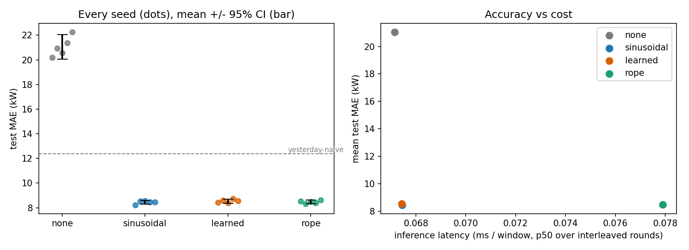
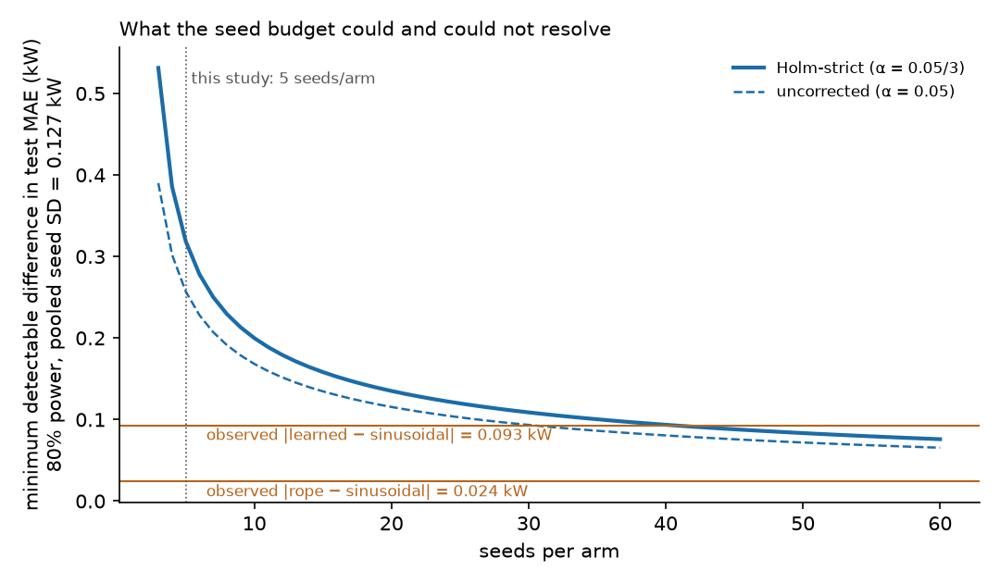

# Does positional encoding matter more than seed noise? A one-GPU ablation for feeder-load forecasting

**Question:** for a 69k-parameter Transformer that forecasts the next 24 hours of rural-feeder demand, does the choice of positional encoding (none, sinusoidal, learned, rotary) change test error by more than run-to-run noise? **Budget:** one free Colab Tesla T4 (14.6 GB), 20 training runs (4 arms × 5 seeds), about 8 minutes of wall-clock for the whole study. **Decision it supports:** whether a small forecasting team should spend engineering time on positional-encoding variants, or keep the cheapest one that works.

Author: Patrick Davis. Repository: https://github.com/davisp8-creator/Week-08-Career-Portfolio. Code is released for review; no license has been chosen yet (add one before publishing). The scenario in `docs/` (a vendor called Cobalt Grid) is fictional. All data are synthetic.

## Headline, with its bounds

On this synthetic benchmark, on one T4 session, with 5 seeds per arm:

1. **Having positional information matters a lot.** Removing it raises test MAE from 8.45 ± 0.13 kW to 21.06 ± 0.80 kW (mean ± seed SD), a gap of 12.6 kW, about 22 seed SDs. It is also worse than repeating yesterday's load (12.37 kW). This holds on the local CPU run too (+12.96 kW).
2. **Sinusoidal, learned and rotary (RoPE) were not distinguishable.** Differences from sinusoidal were +0.09 kW (learned) and +0.02 kW (RoPE), Holm-adjusted p = 0.60 and 0.77. *Not distinguishable is not equal*: with this seed spread, 5 seeds per arm could only have detected a true difference of about 0.26 kW (uncorrected) to 0.32 kW (Holm-strict), roughly 3–4% of the error, at 80% power. Differences below that are unresolved.
3. **RoPE was the most expensive arm** in this implementation: +14% inference latency (13.6–14.2% across four runs in the latest T4 session; +16% in the first), +18% training time (17.4–17.8%; +20% in the first) and +42 MB peak GPU memory on the T4; +34% latency on the CPU. This ordering appeared on both software stacks and in both T4 sessions. The absolute milliseconds apply to these sessions only.

What this does **not** show: that any encoding is best on real feeders, that the differences among the three working encodings are zero, or that the latency numbers transfer to another GPU. See Limitations.

## Results

Test MAE in kW on the held-out chronological test segment (592 windows); lower is better. Mean ± sample SD over 5 seeds (0–4); range in brackets. Reference arm: sinusoidal.

| Arm | Parameters | Test MAE, kW (T4) | Test MAE, kW (CPU) | p50 latency, ms per window (T4) | Train time per run, s (T4) | Peak GPU memory above floor, MB (T4, median of 5) |
|---|---:|---|---|---:|---:|---:|
| none | 68,824 | 21.06 ± 0.80 [20.17–22.26] | 21.39 ± 0.81 | 0.068 | 22.5 | 528 |
| sinusoidal (ref.) | 68,824 | 8.45 ± 0.13 [8.23–8.57] | 8.43 ± 0.13 | 0.069 | 22.7 | 528 |
| learned | 79,576 | 8.54 ± 0.13 [8.41–8.73] | 8.58 ± 0.18 | 0.069 | 22.6 | 528 |
| RoPE | 68,824 | 8.47 ± 0.11 [8.34–8.63] | 8.43 ± 0.10 | 0.079 | 26.7 | 570 |

No-learning baselines: same hours yesterday 12.37 kW; same hours last week 11.84 kW.

| Comparison with sinusoidal (T4) | Δ MAE, kW | Welch 95% CI, kW | Holm-adjusted p | Verdict |
|---|---:|---|---:|---|
| none | +12.61 | [+11.62, +13.60] | 7.2e-06 | exceeds seed noise |
| learned | +0.09 | [−0.10, +0.29] | 0.60 | not distinguishable |
| RoPE | +0.02 | [−0.16, +0.20] | 0.77 | not distinguishable |

**Hardware footnote (T4 column).** Google Colab, Tesla T4 (14.6 GB, sm_75), driver 580.82.07, CUDA 13.0 build; Python 3.13.16, torch 2.11.0+cu130, numpy 2.1.3, pandas 2.2.3; 2-vCPU Xeon host, 12.7 GB RAM; shared VM. Precision: fp32 throughout. Sequence: 168 h in, 24 h out. Batch: 128 (training), 256 (latency), 512 (evaluation). 10 epochs, AdamW, one-cycle schedule, L1 loss. Latency is per window after 5 warm-up forwards, p50 over 30 repeats, mean of 5 interleaved rounds; round-to-round spread ≤ 0.0005 ms. Whole study: 493 s. T4 timings are from the second session; the first session read 0.067 ms (sinusoidal) and 22.3 s. **CPU column:** Intel Core i9-13900HX in a Windows Server 2025 VM, 8 threads pinned, Python 3.14.7, torch 2.14.1+cpu. Raw numbers: `results/*_t4gpu.*`, `results/*_cpu.*`; hardware and library versions: `results/manifest_*.json`.



## Compute reasoning: what 5 seeds could and could not resolve

Seed SD within the three working arms pools to 0.127 kW. From that, `scripts/power_analysis.py` gives the smallest true difference detectable at 80% power and the T4 time to resolve smaller ones (4 arms, about 24 s per run):

| Target difference | Seeds per arm (Holm-strict) | T4 time, all 4 arms |
|---|---:|---:|
| 0.32 kW (3.8% of MAE) | 5 (this study) | about 8 min |
| 0.25 kW | 8 | about 13 min |
| 0.15 kW | 17 | about 27 min |
| 0.10 kW | 36 | about 57 min |
| 0.05 kW | 137 | about 3.6 h |

The learned-vs-sinusoidal gap observed here (0.09 kW) would need roughly 36–40 seeds per arm to settle; a free Colab session could do that in about an hour. The RoPE gap (0.02 kW) is smaller than any affordable budget would resolve and probably does not matter operationally. What more compute would change: the three-way tie might break (or tighten into a defensible equivalence), and a second data seed would put data-sampling variance, currently absent, into the error bars.



## Reproduce

```bash
git clone <this repository> && cd <this repository>
python -m venv .venv && . .venv/bin/activate             # Windows: .venv\Scripts\activate
pip install -r requirements-t4.txt                        # or requirements-cpu.txt
pip install torch==2.11.0 --index-url https://download.pytorch.org/whl/cu130   # CPU: see requirements-cpu.txt

python scripts/run_ablation.py       # with committed results/runs_<tag>.csv present: regenerates every table and plot in about a minute
python scripts/power_analysis.py     # regenerates the power table and figure from the raw per-seed rows
ABLATE_FRESH=1 python scripts/run_ablation.py            # retrain everything: about 8 min on a T4, about 1 h on the CPU used here
```

Output tag is `t4gpu` on a Colab T4, `gpu` on another CUDA device, `cpu` otherwise, so a run never overwrites another machine's results. `ABLATE_QUICK=1` runs a tiny smoke test whose numbers mean nothing. The script refuses to install unpinned packages unless `ALLOW_UNPINNED_INSTALL=1` is set.

Checked from a copy of this repository on the CPU machine: running `python scripts/run_ablation.py` over the committed `runs_cpu.csv` reproduced `summary_cpu.csv`, `comparison_cpu.csv` and `results_cpu.md` byte for byte. **The same check on a T4 has not been done from a clean clone.**

### Run on Colab (T4) or locally with the installers

| Where | How |
|---|---|
| Colab T4 | *Runtime > Change runtime type > T4 GPU*, open `Assignment_08_Portfolio_Colab.ipynb` from GitHub (File > Open notebook > GitHub), then *Run all*. It clones this repo, retrains all 20 runs, runs the power analysis and three whole-study repeats (about 35 minutes), then asks before writing results to this README and again before pushing with your fine-grained token. Runbook: [COLAB.md](COLAB.md) |
| Windows | `powershell -ExecutionPolicy Bypass -File .\Install-Assignment_08_Portfolio_Windows.ps1` |
| macOS | `bash Install-Assignment_08_Portfolio_macOS.command` |

The installers create `.venv`, install `requirements-cpu.txt` and the pinned CPU torch, and offer a smoke test or the resume-from-raw run. Unattended: `-Launch none|quick|full` (Windows) or `LAUNCH=none|quick|full` (macOS).

### Repeat-run status

The headline was measured five times on a Colab T4: the first session, a second session's main run, and three whole-study repeats (every arm and seed retrained) back to back in the second session. The repeats are archived in `results/repeats/t4gpu/` and summarised in the generated section below.

```bash
python scripts/repeat_study.py --n 3     # about 25 min on a T4; archives results/repeats/t4gpu/rep0..rep2 and writes summary.csv/json
```

What the five runs show:
- **Accuracy is deterministic.** Per-run test MAE is bit-identical across all five runs (largest difference 0.0 kW), and so is peak GPU memory (528 MB; 570 MB for RoPE). Every manifest records torch 2.11.0+cu130, Python 3.13.16, driver 580.82.07 and the same data hash.
- **Latency is stable within a session and drifts slightly between sessions.** Arm p50 spread across the three repeats is at most 0.0004 ms. Sinusoidal p50 moved from 0.0674 ms (first session) to 0.069 ms (second), +2.4%.
- **The RoPE cost holds.** +13.6% to +14.2% latency and +17.4% to +17.8% training time across the four second-session runs; +16% and +20% in the first.

What this does not show: the repeats ran back to back on one VM, so they measure determinism and within-session timing noise, not variation across GPUs, drivers or days. Because accuracy is deterministic, repeating the study does not narrow the error bars; the seed spread (about 0.13 kW) remains the only uncertainty estimate for accuracy. To rerun the repeats by hand:

```bash
python scripts/repeat_study.py --n 3     # about 25 min on a T4; finished repeats are skipped on a rerun
```

<!-- RESULTS:BEGIN -->
<!-- Generated by scripts/update_readme.py from results/*.json; edits inside these markers are overwritten. -->
## Measured on each machine (generated)

Same code, seeds and budgets on every machine. **Accuracy should agree across hardware** up to floating-point order; **latency and memory are what the hardware changes.** 'Exceeds noise' means the Holm-adjusted Welch p-value is below 0.05. 'Not distinguishable' means not shown at this seed count, not equal.

### Hardware

| | Local CPU | Colab T4 GPU |
|---|---:|---:|
| Device | CPU only: 13th Gen Intel(R) Core(TM) i9-13900HX, 16 logical cores (virtual machine) | Tesla T4 (14.6 GB, sm_75) |
| Host class | `intel-vm` | `colab-t4` |
| Platform / Python | windows / 3.14.7 | colab / 3.13.16 |
| torch | `2.14.1+cpu` | `2.11.0+cu130` |
| Total script runtime (cumulative) | 3,557.2 s | 493.4 s |
| Data SHA-256 | `2542d60bc3f5…` | `2542d60bc3f5…` |

### Local CPU (`cpu`): 5 seeds per arm, reference arm `sinusoidal`

| Arm | Params | Test MAE, kW (mean ± seed SD) | Range | p50 latency, ms/window | Train s (mean) | Peak GPU MB above floor (median over seeds) |
|---|---:|---:|---:|---:|---:|---:|
| `none` | 68,824 | 21.385 ± 0.813 | 20.19–22.29 | 0.324 | 171.0 s | n/a |
| `sinusoidal` | 68,824 | 8.428 ± 0.129 | 8.29–8.57 | 0.316 | 169.6 s | n/a |
| `learned` | 79,576 | 8.580 ± 0.183 | 8.46–8.90 | 0.310 | 168.9 s | n/a |
| `rope` | 68,824 | 8.429 ± 0.098 | 8.32–8.59 | 0.425 | 187.5 s | n/a |

No-learning references: yesterday-naive 12.37 kW, last-week-naive 11.84 kW.

- none vs sinusoidal: EXCEEDS run-to-run noise (+12.957 kW, +153.7%, none worse; Holm-adjusted p=7.12e-06; effect = 22.3x the seed SD).
- learned vs sinusoidal: NOT distinguishable from noise (+0.152 kW, +1.8%; Welch 95% CI [-0.083, +0.387] includes 0; Holm-adjusted p=0.341).
- rope vs sinusoidal: NOT distinguishable from noise (+0.001 kW, +0.0%; Welch 95% CI [-0.167, +0.170] includes 0; Holm-adjusted p=0.986).


### Colab T4 GPU (`t4gpu`): 5 seeds per arm, reference arm `sinusoidal`

| Arm | Params | Test MAE, kW (mean ± seed SD) | Range | p50 latency, ms/window | Train s (mean) | Peak GPU MB above floor (median over seeds) |
|---|---:|---:|---:|---:|---:|---:|
| `none` | 68,824 | 21.060 ± 0.801 | 20.17–22.26 | 0.068 | 22.5 s | 527.992 |
| `sinusoidal` | 68,824 | 8.449 ± 0.132 | 8.23–8.57 | 0.069 | 22.7 s | 528.074 |
| `learned` | 79,576 | 8.542 ± 0.134 | 8.41–8.73 | 0.069 | 22.6 s | 528.197 |
| `rope` | 68,824 | 8.473 ± 0.114 | 8.34–8.63 | 0.079 | 26.7 s | 570.014 |

No-learning references: yesterday-naive 12.37 kW, last-week-naive 11.84 kW.

- none vs sinusoidal: EXCEEDS run-to-run noise (+12.612 kW, +149.3%, none worse; Holm-adjusted p=7.23e-06; effect = 22.0x the seed SD).
- learned vs sinusoidal: NOT distinguishable from noise (+0.093 kW, +1.1%; Welch 95% CI [-0.101, +0.287] includes 0; Holm-adjusted p=0.601).
- rope vs sinusoidal: NOT distinguishable from noise (+0.024 kW, +0.3%; Welch 95% CI [-0.157, +0.205] includes 0; Holm-adjusted p=0.767).


### Repeat runs on `t4gpu`: the whole study retrained 3 times

| Arm | Test MAE, kW (mean of repeat means) | Spread of repeat means, kW | p50 latency, ms/window | Latency spread, ms | Train s per run | Train-time spread, s |
|---|---:|---:|---:|---:|---:|---:|
| `learned` | 8.542 | 0.000 | 0.0689 | 0.0002 | 22.9 | 0.1 |
| `none` | 21.060 | 0.000 | 0.0685 | 0.0002 | 22.8 | 0.0 |
| `rope` | 8.473 | 0.000 | 0.0785 | 0.0004 | 26.8 | 0.0 |
| `sinusoidal` | 8.449 | 0.000 | 0.0689 | 0.0003 | 22.8 | 0.0 |

Largest per-run test-MAE difference between repeats: 0.000e+00 kW (bit-identical).

<!-- RESULTS:END -->

## Limitations, and how to discount the result

1. **Synthetic data and one data seed.** The seed spread covers initialisation and batch order only. Real feeders have metering gaps, solar, EV charging and weather extremes, and the regular seasonal structure here may be exactly why three encodings tie. The 8.4 kW absolute error is an artefact of the generator's noise. *Discount:* trust within-benchmark comparisons and orderings; do not quote the accuracy as field performance.
2. **Low statistical power.** 5 seeds per arm; real differences up to about 0.3 kW (3–4%) could have been missed. No equivalence margin was set in advance. *Discount:* read "not distinguishable" as "unresolved below about 0.3 kW".
3. **Two Colab sessions on one GPU type, and a stack confounded with the hardware.** The CPU and T4 runs differ in device, Python, torch, numpy and pandas together. On the T4, accuracy and memory repeat exactly and latency repeats within 0.0004 ms inside a session, but latency moved 2.4% between the two sessions and no other GPU was tried. *Discount:* treat latency and training-time percentages as indicative; the relative RoPE penalty is the more trustworthy part because it shows on both stacks and in both T4 sessions.
4. **One model size, one sequence length, one horizon.** At 69k parameters and batch 256 the forward pass is likely dominated by kernel-launch overhead; I did not profile it to confirm. A larger model or a fused attention kernel could reverse the cost ordering. *Discount:* do not extrapolate the cost ranking to other model sizes.
5. **Partial control.** The learned arm has 15.6% more parameters; a seed does not give identical initial weights across arms, so the unpaired Welch test is primary; hyperparameters were not tuned per arm. A tuned optimiser for one arm could change the tie.
6. **Memory is a script peak, not a deployment footprint.** The 528 MB peak is dominated by the 512-window evaluation batch's attention maps; the model is under 1 MB. The first CUDA run of a session paid an extra 65 MB of library workspace, so the median over seeds is reported.
7. **One chronological split, 592 test windows,** and Holm correction over the three accuracy comparisons only; the latency and memory comparisons carry spread but no formal test.

## Intended use and out-of-scope use

**Intended:** evidence for an internal architecture decision about positional encoding in a small day-ahead feeder-load forecaster, and a worked example of an auditable single-GPU ablation. **Out of scope:** automatic switching, protection or load-shedding without a human in the loop; individual-customer prediction; billing; any claim of accuracy on real feeders; generalisation to other model sizes or other ablated factors.

## Data, models and versions

- **Data provenance:** 100% synthetic, generated by `scripts/run_ablation.py` from `data_seed: 1234` (8 feeders × 540 days × hourly = 103,680 rows). No download, no personal data, no real utility data. SHA-256 `2542d60bc3f531a7a6ef4487616fc51681723c60ec259bca0a778508c0ac6cd2`, identical on both machines. Generative assumptions (daily load shapes, weekday and holiday factors, temperature response, summer-night irrigation, 4% multiplicative noise, rare outages) are the author's, not measured behaviour.
- **Licensing:** no third-party data. Libraries keep their own licenses (PyTorch, NumPy, pandas, SciPy, Matplotlib: BSD-style). The repository's own license is not yet chosen.
- **Model:** 2-layer, 4-head, width-64 Transformer encoder, last-token linear readout; 68,824 parameters (79,576 with learned encodings). No pretrained weights. Trained from scratch in every run.
- **Evaluation protocol:** chronological 70/15/15 split per feeder, normalisation fitted on train only, no window crosses a split. Test MAE and RMSE in kW at the best-validation epoch, computed once. Seeds are the outer loop and arm order inside a seed is shuffled; batch order depends on the seed only. Welch two-sample test against the reference, Holm-corrected; paired test is secondary. Latency in interleaved rounds with `cuda.synchronize()`.
- **Known failure modes:** the `none` arm cannot tell hours apart and loses to a naive baseline; peak-hour error, bias and uncertainty coverage were not measured; outages and spoofed sensor input were not tested.
- **Regulatory documentation:** `docs/ANNEX_IV_TECHNICAL_DOCUMENTATION.md` summarises the study in EU AI Act Annex IV order with NIST AI RMF and ISO/IEC 42001 mappings. It is a draft for a research study, not a conformity file; open items are marked **[OPEN]**.

## Why this matters here

**Target:** data scientist / ML engineer on a small load-forecasting team at a rural electric cooperative, or at a vendor that sells forecasts to them. Such a team has no GPU cluster, one or two analysts, a procurement desk that buys power a day ahead, and a board and regulator that ask what a model change costs and how sure you are. Peak-hour misses become expensive spot purchases, and any automated use of a forecast in grid operation could raise the EU AI Act high-risk question that Annex III(2) leaves open. This package shows the habits that team needs: pick a question that fits one free GPU, report error in kW rather than a leaderboard score, say how big a difference you could not have seen, price the options in seconds and megabytes, and leave documentation a compliance reviewer can read without the code.

## Skills demonstrated

| Skill | Evidence in this repository |
|---|---|
| Controlled ablation and seed variation | one factor changes in `configs/ablation.yaml`; 20 runs; per-seed rows in `results/runs_t4gpu.csv` |
| Honest benchmarking | interleaved latency rounds with sync and warm-up (`results/latency_runs_t4gpu.csv`); median-over-seeds memory; claims bounded above |
| Statistical reasoning under a compute budget | Welch + Holm in `results/comparison_t4gpu.csv`; power and seed-cost table from `scripts/power_analysis.py` |
| Memory budgeting and profiling | peak-memory analysis showing the 528 MB is evaluation attention maps, not the 0.07 M-parameter model |
| Reproducible packaging | pinned specs for both stacks, data SHA-256, hardware manifests, resume-from-raw entry point, repeat harness |
| Self-audit | `AUDIT.md`: eight findings against my own earlier submission, each with a status |
| Model documentation for regulators | `docs/ANNEX_IV_TECHNICAL_DOCUMENTATION.md`; intended-use and failure-mode sections above |

## Repository layout

```
README.md                  this file
AUDIT.md                   what the original submission could not support, and what changed
configs/ablation.yaml      every budget, in one place
scripts/run_ablation.py    entry point: data, training, latency, statistics, tables, plots
scripts/power_analysis.py  minimum detectable difference and seed cost from raw runs
scripts/repeat_study.py    repeat the study N times and measure determinism and spread
scripts/build_notebook.py  builds the Colab notebook and the simplified script from run_ablation.py
scripts/update_readme.py   renders the generated results section; optional commit and push with a token
Assignment_08_Portfolio_Colab.ipynb   generated; run it on a Colab T4
Install-Assignment_08_Portfolio_*     Windows and macOS installers
COLAB.md                   T4 runbook
env_setup.py               hardware detection and pinned-package check
requirements-t4.txt, requirements-cpu.txt
results/                   <name>_<tag>.{csv,json,md,png}; raw rows in runs_<tag>.csv
docs/                      Annex IV technical documentation summary, one-page summary
```
